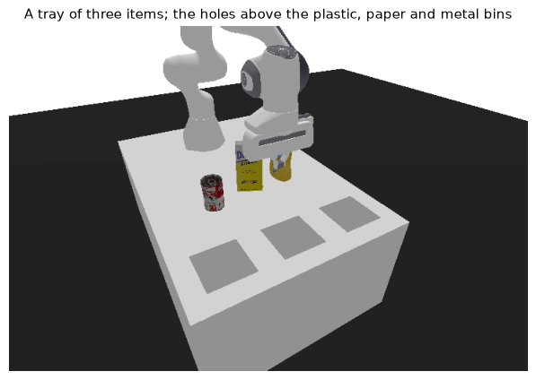
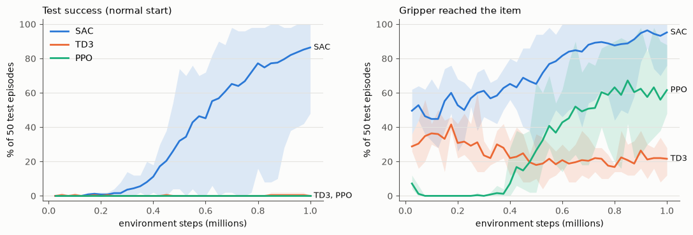
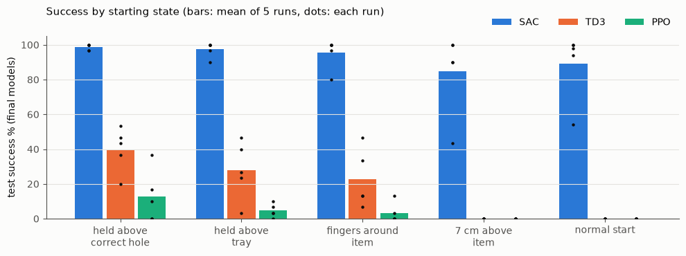
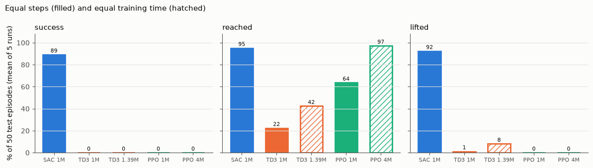
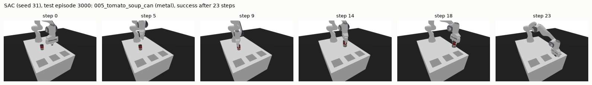

# Robotic Waste Sorting with Deep RL: SAC vs PPO vs TD3

    

Can a robot arm learn the pick-and-place part of recycling by reinforcement learning, and which deep RL algorithm is most practical when samples are expensive? We built a simulated waste-sorting cell with a **Franka Panda arm** and **seven real household objects** from the YCB set, and compared **PPO, SAC and TD3** under one fair protocol.

**Result: with the same 1M environment steps, only SAC learned the task: 89.2% test success vs 0% for PPO and TD3**, and it transferred to multi-item trays it was never trained on.



*UTS 43008 Reinforcement Learning, Assignment 3 (Spring 2026). Team 3H, Project 53: Hyojeong Yu, Heesu Kim, Hyunbeen Suk.*

## Results

Final runs: the selected configuration of each algorithm, 5 training seeds (31-35), 50 unseen test episodes per condition (seeds 3000-3049), deterministic actions. Mean (SD) over seeds.

| % of test episodes | PPO | **SAC** | TD3 |
|---|---|---|---|
| Gripper reached the item | 63.6 (18.5) | **95.2 (10.7)** | 22.4 (7.8) |
| Item lifted | 0.0 (0.0) | **92.4 (15.9)** | 1.2 (2.7) |
| **Success, nominal items** | 0.0 (0.0) | **89.2 (19.8)** | 0.0 (0.0) |
| Success, training randomisation | 0.0 | **88.8 (19.7)** | 0.0 |
| Success, mass x2 | 0.0 | **86.0 (23.7)** | 0.4 (0.9) |
| Success, friction x0.5 | 0.0 | **79.6 (23.4)** | 0.0 |
| Success, size x1.2 | 0.0 | **57.2 (16.8)** | 0.0 |
| Tray of 3 (spaced): items sorted | 0.0 | **83.6 (19.3)** | 0.3 (0.8) |
| Tray of 4 (spaced): items sorted | 0.0 | **78.4 (23.1)** | 0.0 |
| Tray of 3 (dense): items sorted | 0.0 | **59.2 (15.5)** | 0.0 |

Per-seed values are in `results/final/final_results.csv` (SAC nominal success by seed: 100 / 100 / 98 / 54 / 94%).



**Where each algorithm stops.** Testing the final models from curriculum start states locates the failure: SAC succeeds from every start; TD3 can grasp, lift and carry from easy starts but never learned the final descent that puts the fingers around the item; PPO reaches the item in 64% of episodes but never lifts it.



**Supplementary checks.** PPO with observation/reward normalisation (VecNormalize) reached the item more often but still never lifted it. Giving TD3 (1.39M steps) and PPO (4M steps) the same training *time* as SAC did not produce a single success either.





## Method

- **Task.** One item stands on the tray; its category (plastic, paper, metal) and pose are known, as from an upstream vision system. The arm must reach it, turn its wrist to the item's narrow side, grasp, lift, carry it and drop it through the hole above the correct bin within 100 steps. Pushing an item into a hole without lifting it, the wrong hole, or dropping it off the table is a failure.
- **MDP.** 33-dimensional state (gripper, item pose/velocity/size, one-hot category, lifted flag, gripper-to-grasp-point vector, wrist angle relative to the narrow side as sin 2Δ / cos 2Δ); 5-dimensional continuous action (gripper xyz, wrist yaw, finger opening).
- **Reward.** Potential-difference shaping for reaching, grasping, lifting and carrying, -0.01 per step, +5 on success, -5 on failure. Scripted checks confirm that behaviours which never sort earn less than sorting.
- **Learning aids (same for every algorithm).** A reverse start-state curriculum (item held above the correct hole, above the tray, or between the open fingers; 50% of episodes at first, 0% by 60% of training) and physical randomisation (mass and friction x0.7-1.3, size x0.9-1.1).
- **Solvability check.** A hand-written grasp-lift-carry controller reaches 98.6% success on nominal items.
- **Fair protocol.** Same environment, reward, curriculum and 2x256 networks for all three; 1,000,000 steps per run; three candidate configurations per algorithm x seeds 21-23 for selection (50 selection episodes, seeds 1000-1049, never used for testing); the selected configuration retrained with five new seeds.

| Algorithm | Selected configuration |
|---|---|
| SAC | `SAC_robotics_gamma`: lr 3e-4, γ 0.95, τ 0.02, learning starts 2,000, automatic entropy |
| TD3 | `TD3_robotics_gamma`: lr 3e-4, γ 0.95, τ 0.02, learning starts 2,000, noise σ 0.1 |
| PPO | `PPO_small_lr`: lr 1e-4, γ 0.98, rollout 512 x 4 envs, batch 128 |

## Limitations

- One environment, five final seeds and 50 test episodes per condition; SAC's nominal success ranged from 54% to 100% across seeds.
- Three hand-designed candidates per algorithm rather than an equal-budget hyperparameter search; only SAC and TD3 had a candidate based on published robot-arm settings (γ = 0.95).
- No hindsight experience replay or demonstrations; the agent sees exact object states (no camera), items are always upright, and everything runs in simulation.

## Team and my contribution

| Member | Role |
|---|---|
| Hyojeong Yu | PPO agent and experiments; drafts of the earlier project parts and the first versions of the shared environment and notebook; project coordination |
| **Hyunbeen Suk** | **SAC agent, its three candidate configurations and experiments; developed the shared environment into its final form (lift-and-drop success rule, wrist rotation, reverse curriculum, the seven YCB objects, physical randomisation, multi-item tray evaluations); fairness audit; packaged the environment and experiment pipeline; ran the final SAC and TD3 experiments; diagnostic analyses; final code notebook and first full report draft** |
| Heesu Kim | TD3 agent and experiments; local environment setup and dependency fixes; smoke tests; analysis of reaching/grasping/lifting results |

## Code guide


| File or folder | Contents |
|---|---|
| `Group53_3H_Robotic_Waste_Sorting_Final.ipynb` | The final notebook. It contains the complete code (each script below is written by one of its cells), the environment checks and every result in the report, with the outputs of the actual runs. |
| `waste_env.py` | The environment (Gymnasium API, built on panda-gym / PyBullet) |
| `train_eval.py` | One run: trains one configuration with one seed for 1,000,000 steps, then runs the full evaluation |
| `run_all.py` | Runs the whole experiment on one machine: selection stage, automatic choice of configuration, final runs |
| `run_stage.py` | Runs one stage for one algorithm (used for the equal-training-time comparison) |
| `select_config.py` | Picks each algorithm's configuration from the selection stage, by the rule fixed in Part C |
| `report_results.py` | Prints the final results table (mean and standard deviation over the five final seeds) |
| `build_assets.py` | Builds the seven YCB items into `assets/ycb/` (already built here) |
| `assets/ycb/` | The YCB items used by the environment |
| `results/` | Main comparison: selection stage (`selection/`), final runs with the trained models (`final/`), run log |
| `results_ppo_norm/` | Supplementary comparison A: PPO with observation and reward normalisation (VecNormalize) |
| `results_equal_time/` | Supplementary comparison B: equal training time (PPO 4,000,000 and TD3 1,390,000 steps) |
| `live_demo/` | The live demo shown in the presentation, and the script that rendered the demo video |

### Setup

Python 3.11, then from this folder:

```
python -m venv .venv
source .venv/bin/activate          # Windows: .venv\Scripts\activate
pip install -r requirements.txt
```

If `pybullet` fails to install on Windows, install it first with `conda install -c conda-forge pybullet`. The results
were produced on an Apple M5 MacBook (CPU, one torch thread per run).

### Running the notebook

Open the notebook in this folder and run it from the top. The training runs (1,000,000 steps each, about 10 hours in
total) are not repeated inside the notebook: it reads their result files from the `results*` folders. The notebook
mentions `results_bundle.zip`; its contents are already unpacked here as these folders.

### Trained models

Every final run has its trained model, `model_final.zip`, in its run folder:

| Comparison | Run folders (training seeds 31–35) |
|---|---|
| Main | `results/final/SAC_robotics_gamma_seed31` … `seed35`, `results/final/TD3_robotics_gamma_seed31` … `seed35`, `results/final/PPO_small_lr_seed31` … `seed35` |
| A: PPO + normalisation | `results_ppo_norm/final/PPO_small_lr_seed31` … `seed35` (also `obs_norm_final.npz`, the normalisation statistics) |
| B: equal training time | `results_equal_time/final/TD3_robotics_gamma_seed31` … `seed35`, `results_equal_time/final/PPO_small_lr_seed31` … `seed35` |

Each run folder also has `summary.json` (all test results), `test_nominal.csv` (each test episode) and the training
monitor files. To load a model and run test episodes:

```python
from pathlib import Path
import train_eval as T, waste_env as W

model = T.load_model("SAC", Path("results/final/SAC_robotics_gamma_seed31/model_final.zip"))
# for results_ppo_norm models also: model.obs_norm = T.load_obs_norm(<run folder> / "obs_norm_final.npz")
rows = W.run_episodes(T.policy(model), range(3000, 3050), **T.ENV_FLAGS)     # the 50 test episodes
print(sum(r["success"] for r in rows) / len(rows))
```

`python train_eval.py --evaluate-only results/final/SAC_robotics_gamma_seed31` runs the full evaluation of a saved
model again. Not included because of their size (about 8 GB): the checkpoints saved every 25,000 steps and the models of
the selection stage. The checkpoint tests used in Section 7.5 of the notebook are stored in
`results/analysis/stage_checkpoints.csv`.

### Training again

These are the commands used, from this folder (five runs at a time):

```
python run_all.py --max-parallel 5 --min-free-gb 3.0 --stop-gb 2.0          # main comparison + supplementary A
python run_stage.py --algo PPO --stage final --equal-time --max-parallel 5  # supplementary B
python run_stage.py --algo TD3 --stage final --equal-time --max-parallel 5
python report_results.py                                                    # results table
```

Runs that already have a `summary.json` are skipped, so to train from scratch, use a copy of this folder without the
`results*` folders. `python run_all.py --smoke` checks the whole pipeline with 3,000-step runs.

### Live demo

`live_demo/Live_Demo.ipynb` loads the final SAC model (seed 31) and draws one test episode at a time below the cell,
in slow motion, and checks that the outcome is the same as in the evaluation. It also needs `imageio` and
`imageio-ffmpeg` (`pip install imageio imageio-ffmpeg`). `live_demo/make_demo_video.py` rendered the demo video shown in the presentation. Compared with the versions used for the presentation, only the folder paths were changed and a fallback
was added for computers without the macOS Arial font.

## Acknowledgements

Simulation built on [panda-gym](https://github.com/qgallouedec/panda-gym) and [PyBullet](https://pybullet.org); algorithms from [Stable-Baselines3](https://github.com/DLR-RM/stable-baselines3). Object models from the [YCB Object and Model Set](https://www.ycbbenchmarks.com/) (CC BY 4.0).
